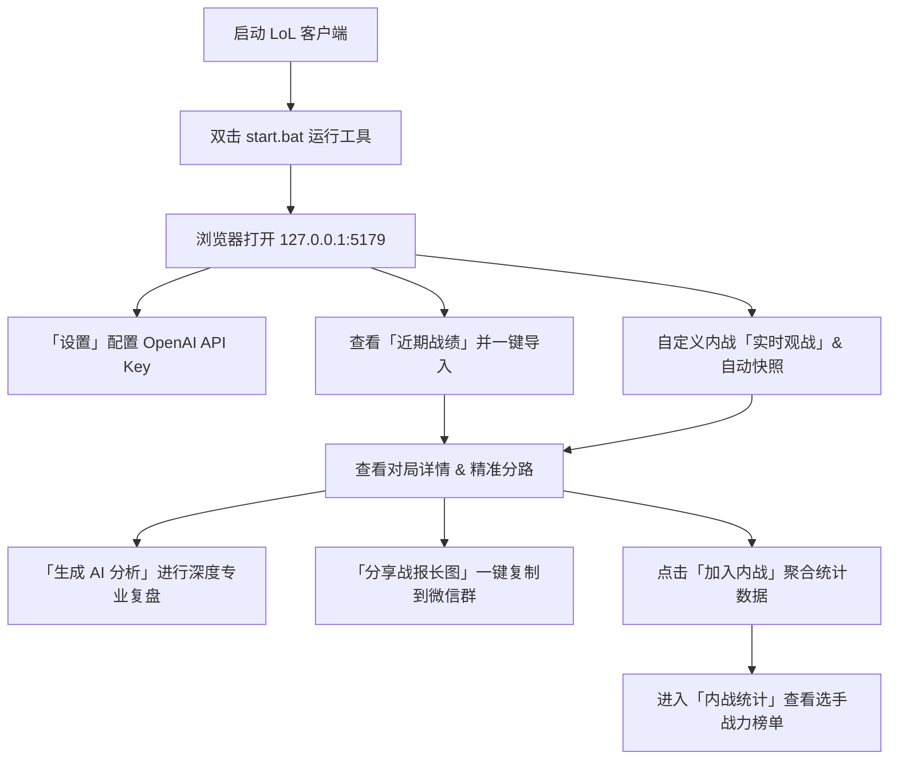

# LoL Match Lab (英雄联盟对局实验室) 🎮

> 基于 Riot LCU API 与本地实时观战流的英雄联盟对局分析、内战统计看板与 AI 智能复盘工具。

[](https://nodejs.org/)
[](LICENSE)
[]()

---

## 🌟 核心特性 (Features)

1. **⚡ 零配置极速连接 (LCU Integration)**
   - 自动探测正在运行的英雄联盟客户端（支持国服及各外服），无需手动输入账号密码即可安全直连。
   - 具备进程特征探测与 Lockfile 兜底机制，亦支持在设置中手动指定端口与通信密钥。

2. **👁️ 实时观战看盘 & 智能防丢失快照 (Live Spectate & Auto-Snapshot)**
   - **观战身份友好**：以导播或观战者身份加入自定义房间时，支持实时心跳轮询 Live Client 数据。
   - **全自动分钟级快照**：支持比赛进行中每分钟自动落盘快照，退出观战前触发终局保护快照。
   - **对局流失救回**：比赛结束后后台全自动追踪探测，即便客户端提前关闭或官方未及时归档，亦可从本地终局快照 100% 还原并一键导入对局。

3. **🎯 全自动峡谷分路还原引擎 (Lane Recognition Engine)**
   - 针对自定义内战中拳头官方接口默认返回 `lane: "NONE"` 的痛点，内置自研的三维分路识别算法：
     - **打野**：自动检测携带惩戒（Smite）召唤师技能；
     - **辅助**：自动检测携带专属辅助装备（3850~3880 系列）与高视野比；
     - **上单 / 中单 / 下路**：提取第 2~7 分钟峡谷时间线真实移动走位坐标（Timeline Coordinates），通过空间聚类算法 100% 精确还原对线分路。
   - 完美适配上单薇恩、中单艾翁、下路亚索等非常规黑科技对位！

4. **🤖 AI 深度复盘与幽默锐评 (AI Match Review)**
   - 支持接入 **OpenAI** 官方接口或任意兼容网关（OneAPI / NewAPI / DeepSeek / Moonshot 等）。
   - **专业职责化点评**：AI 严格根据精准推导的标准分路进行点评（上单单带线权、打野控龙控虫节奏、中路游走爆发、下路发育收割、辅助视野开团），彻底告别“推测是某某分路”的模糊描述。
   - **自定义风格定制**：内置提示词调节，支持内战娱乐锐评风格（如“上等马/下等马分级”、“操作瑕疵捉虫”等）。

5. **📊 内战专属多维统计看板 (Inner War Analytics)**
   - 专为水友赛、熟人内战、战队训练赛设计。
   - 自动计算双方胜率、全场 MVP / SVP 次数榜、选手场均 KDA / 参团率排行榜、英雄胜率榜与战力曲线。
   - 支持一键将对局添加至内战库或移除管理。

6. **🎨 一键生成精美战报长图海报 (Share Poster)**
   - 内置纯前端 Canvas 渲染引擎，一键生成高清战报长图。
   - 涵盖双方阵营对位、分路徽章、装备与补刀、伤害经济占比、AI 成员点评与综合总结。
   - 支持**一键复制到剪贴板**或**下载图片**，方便直接发送到手机微信群交流复盘。

7. **📦 原生零依赖极简架构**
   - 采用纯原生 Node.js 构建，**无需 `npm install` 下载庞大依赖库**，即下即跑、秒级启动。
   - 离线数据缓存机制，即使退出游戏客户端也能流畅查看历史战报与英雄装备数据。

---

## 🚀 快速上手 (Quick Start)

### 环境要求
- **Node.js** >= 18.0.0
- **操作系统**：Windows 10/11 或 macOS
- 电脑已启动英雄联盟客户端（并已登录游戏大厅）

### 启动运行

#### 方式一：Windows 免安装独立桌面客户端（推荐普通用户）
无需安装 Node.js、无需配置环境、即解压即用：
1. 下载并解压发布压缩包 **`dist/LoL对局实验室.zip`**；
2. 直接双击运行 **`dist/LoL对局实验室/LoL对局实验室.exe`**；
3. 程序直接弹出**独立的 Windows 原生客户端软件窗口**（基于 Edge WebView2 原生容器，**无需打开外部浏览器标签页**），所有操作直接在软件窗口中流畅完成！所有数据与配置均持久化保存在同级 `data/` 目录中。

#### 方式二：Windows 脚本启动（开发者源码运行）
电脑已安装 Node.js >= 18 的开发者，可直接双击项目根目录下的 **`start.bat`** 启动。

#### 方式三：命令行启动
```bash
# 进入项目根目录
cd lol-match-lab

# 启动服务并在浏览器打开
npm start

# 或仅在后台运行服务
npm run serve
```
启动成功后，浏览器访问：`http://127.0.0.1:5179`

---

## 📖 使用指南 (User Guide)



### 1. 首次配置 (Settings)
1. 点击顶部导航栏的 **「设置」** 页面；
2. 填写您的 OpenAI 配置：
   - **Base URL**：例如官方 `https://api.openai.com/v1` 或您的第三方中转地址；
   - **API Key**：填写对应的 API Key（保存在本地，绝不上云）；
   - **Model**：例如 `gpt-4o-mini`、`gpt-4o`、`deepseek-chat` 等；
   - **额外要求 (Extra Prompt)**：可自由填写希望 AI 侧重的复盘风格（如幽默锐评、战术严谨等）；
3. 检查顶部 **LCU 状态指示灯**，显示为绿色 `已连接 (imking#6688)` 即代表客户端连接就绪。

### 2. 战绩浏览与一键导入
- **历史战绩**：主页展示当前召唤师近期比赛记录，点击任意一场即可在线解析并保存到本地对局库；
- **手动导入**：如需查看他人对局或指定对局，可在右上角输入对局 ID（如 `21021724`）点击导入。

### 3. 自定义局/内战观战与实时快照
- 当您作为**观战者/裁判**进入一场自定义比赛时，切换到 **「实时观战」** 页面；
- 开启「自动快照」开关（建议默认 1 分钟/次），系统会在后台静默抓取整场比赛的实时局势与装备曲线；
- 比赛结束时，系统会自动捕捉终局状态并尝试关联完整对局；若比赛退场后客户端未索引，可随时在「快照库」中一键将快照转存为正式对局进行查看。

### 4. AI 智能复盘与微信长图分享
- 进入任意已导入的对局详情页；
- 系统已自动推导出每位选手的精确分路（【上单】、【打野】、【中单】、【下路】、【辅助】）；
- 点击 **「生成 AI 分析」**，模型将结合经济发育、对线换血、参团贡献及 10 人的对位数据输出精准无“推测”字样的专业报告；
- 点击 **「分享战报长图」**，自动合成高颜值长图，支持一键复制到剪贴板，直接粘贴发送至微信群。

### 5. 内战统计看板
- 在对局详情页右上角点击 **「加入内战」**；
- 切换至 **「内战统计」** 页面，系统自动汇总所有已收录内战：
  - 胜率走势、红蓝方胜率对比；
  - 选手 MVP / SVP 排行榜、场均 KDA 与场次排行；
  - 核心英雄选用池与选手偏好。

---

## 📁 项目目录结构 (Directory Structure)

```text
lol-match-lab/
├── package.json          # 项目配置文件（原生 Node，零三方包依赖）
├── start.bat             # Windows 一键启动脚本
├── .gitignore            # Git 忽略配置（保护个人数据与密钥）
├── README.md             # 项目使用说明文档
├── data/                 # 本地持久化数据存储目录
│   ├── settings.example.json # 设置配置模板
│   ├── settings.json     # [本地] 用户实际配置与 API 密钥（Git 忽略）
│   ├── matches/          # [本地] 本地已导入的对局数据 JSON（Git 忽略）
│   ├── spectate/         # [本地] 实时观战抓取的快照与存档（Git 忽略）
│   ├── ai/               # [本地] AI 复盘报告本地缓存（Git 忽略）
│   └── static/           # 英雄/装备/技能静态资源落盘缓存
├── public/               # 前端单页面应用 (原生 HTML/CSS/JS)
│   ├── index.html        # 单页面主入口
│   ├── style.css         # UI 样式表（深色电竞质感）
│   ├── app.js            # 前端路由与状态管理
│   ├── poster.js         # Canvas 战报长图海报生成器
│   ├── pages/            # 各功能页面组件
│   │   ├── history.js    # 战绩列表页
│   │   ├── match.js      # 对局详情与 AI 分析页
│   │   ├── innerwar.js   # 内战统计看板页
│   │   ├── lcu.js        # 实时观战监控面板
│   │   └── settings.js   # 设置配置页
│   └── ...
├── server/               # 后端服务 (Node.js 原生 HTTP)
│   ├── index.js          # HTTP API 服务入口与路由派发
│   ├── lcu.js            # Riot LCU 进程探测、Lockfile 与通信层
│   ├── analysis.js       # 核心算法：峡谷三维分路识别与战报解析
│   ├── ai.js             # AI 复盘 Prompt 构造与 OpenAI 调用
│   ├── watcher.js        # 实时观战心跳轮询与快照持久化服务
│   ├── matches.js        # 对局历史查询与详情聚合
│   ├── innerwar.js       # 内战数据计算与汇总引擎
│   └── store.js          # 本地文件读写与原子化写入存储
├── launcher.py           # Windows 独立桌面控制台与生命周期守护管理器
├── build.py              # 一键生成图标并调用 PyInstaller 打包为单文件 EXE 与 ZIP
├── build.bat             # Windows 一键打包批处理快捷脚本
├── README.txt            # 面向终端用户的纯文本使用说明书
└── scripts/              # 诊断与烟测脚本
```

---

## 🛠️ 开发者指南：一键打包为 EXE 与发布压缩包

参考独立免安装工具（如 HardwareShot）的打包分发设计，本项目提供完整的单文件打包与发布流程：

```bash
# 方式一：运行 Python 脚本
python build.py

# 方式二：Windows 快捷批处理
双击运行 build.bat

# 方式三：npm 脚本
npm run build
```

打包完成后，产物位于 **`dist/`** 目录：
- **`dist/LoL对局实验室/LoL对局实验室.exe`**：单文件便携可执行程序（内置 Node 运行时与静态资源，无需目标电脑安装 Node.js）
- **`dist/LoL对局实验室/使用说明.txt`**：随分发包附带的快速上手说明
- **`dist/LoL对局实验室.zip`**：可直接通过微信、QQ、网盘发送给水友或好友的完整解压即用包

---

## ❓ 常见问题排查 (FAQ)

### Q1: 提示“无法连接到英雄联盟客户端”？
1. 请确认英雄联盟客户端已正常启动并进入大厅界面；
2. 如果是国服且使用了特殊启动方式，请确保以**普通用户身份**或与客户端**相同权限**运行 `start.bat`；
3. 您可以在「设置」页面手动指定客户端所在安装目录，或填写端口和 Token。

### Q2: 自定义对局打完后，导入提示 404 或找不到？
1. 自定义比赛在刚打完退出瞬间，拳头服务器生成比赛归档可能需要 15~30 秒，稍等片刻后再次点击导入即可；
2. 若该局是纯观战且官方未提供终局接口，只要开启过「实时观战」，可直接在「快照库」中将退场前保存的快照一键转存为正式对局。

### Q3: AI 复盘提示“请求 OpenAI 失败”或超时？
1. 请检查「设置」中的 API Key 与 Base URL 是否正确；
2. 若在中国大陆网络环境下直连官方 `api.openai.com` 可能会超时，建议在设置中配置可访问的反向代理网关或使用国内兼容大模型。

---

## 🛡️ 安全与隐私声明

- **零上传保障**：本工具所有对局数据、快照文件及配置密钥均完全保存在您本机的 `data/` 目录中；
- **密钥安全**：`.gitignore` 已默认严格排除 `data/settings.json` 及所有个人对局数据，防止在提交代码或共享项目时不慎泄露私有 API Key。

---

## 📄 License

[MIT License](LICENSE)
